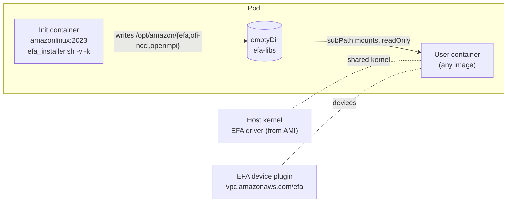

# Platform-Managed EFA Runtime for Kubernetes

Run multi-node communication over [Elastic Fabric Adapter (EFA)](https://aws.amazon.com/hpc/efa/) on Kubernetes without engineers having to configure the network stack in their own containers.

An **init container** installs the EFA user-space stack (libfabric with the EFA provider, aws-ofi-nccl, and OpenMPI) into a shared `emptyDir` volume while the pod starts. The application container then mounts that stack **read-only**. The platform team owns the whole EFA lifecycle: installation, version management, libfabric tuning, and OpenMPI. Application images stay free of AWS-specific network dependencies. This pattern is sometimes called *EFA injection*.

> **Status: proof of concept.** This was validated with an NCCL `all_reduce_perf` test between two `p5.48xlarge` instances on Amazon EKS. The test showed that the platform can deliver the EFA runtime into an unmodified container. It was not tuned for performance.

---

## Problems this solves

| Problem | EFA managed in each app image | Platform-Managed EFA Runtime |
|---|---|---|
| **Tight coupling** | Every user image has to include matching versions of libfabric, aws-ofi-nccl, and the EFA user-space libraries. | User images don't include any EFA components. The platform supplies them when the pod starts. |
| **Version drift** | Each new EFA installer release means rebuilding every image. Skipping the rebuild risks slower runs or failures that are hard to debug. | The platform changes one version setting. The next pod launch picks up the new stack. |
| **Expertise** | Engineers need to know the EFA library stack, which versions work together, build flags, and runtime dependencies. | The platform team holds that knowledge in one place. |

## How it works



1. **Init container** (`public.ecr.aws/amazonlinux/amazonlinux:2023`) mounts the `efa-libs` volume at `/opt/amazon` and runs the [EFA installer](https://docs.aws.amazon.com/AWSEC2/latest/UserGuide/efa-start.html) with `-y -k` (non-interactive, skip the kernel module). The EFA kernel driver is already loaded on the host by the AMI, and containers share the host kernel, so only user-space libraries are needed.
2. The installer writes:
   - `/opt/amazon/efa/`: libfabric, the EFA provider plugin, and the `fi_info` diagnostic tool
   - `/opt/amazon/openmpi/`: OpenMPI runtime
   - `/opt/amazon/ofi-nccl/`: the aws-ofi-nccl plugin
3. **rdma-core and netlink libraries are copied** from `/usr/lib64` into `/opt/amazon/efa/lib64`. The EFA provider links against `libibverbs`, `librdmacm`, `libnl-3`, and `libnl-route`, and the installer puts those in system paths that are not on the shared volume. Without this copy, NCCL fails in the user container.
4. **User container** mounts only the `efa`, `ofi-nccl`, and `openmpi` sub-paths, each read-only. It does not mount the whole volume over `/opt/amazon`, so anything else the image keeps there stays visible.
5. **Environment variables** point libfabric at the platform-provided provider (see [Configuration](#configuration)).

For more detail, see [docs/architecture.md](docs/architecture.md).

## Repository layout

```
.
├── manifests/
│   ├── mpijob-nccl-allreduce-p5.yaml            # Full validated test: 2 x p5.48xlarge NCCL all-reduce
│   └── snippets/
│       └── platform-managed-efa-pod-spec.yaml   # Minimal fragment to copy into your own pod specs
├── scripts/
│   ├── provision-efa-runtime.sh                 # Init container logic as a standalone script
│   └── verify-efa-runtime.sh                    # Checks a running pod for a correctly provisioned runtime
└── docs/
    └── architecture.md                          # Design details, alternatives, limitations
```

## Prerequisites

- An Amazon EKS cluster with EFA-capable GPU nodes, such as `p5.48xlarge`, in a placement group or a single AZ, with an EFA-enabled security group.
- A node AMI that loads the EFA kernel driver, such as the EKS-optimized accelerated AMI.
- [NVIDIA device plugin](https://github.com/NVIDIA/k8s-device-plugin), which exposes `nvidia.com/gpu`.
- [AWS EFA Kubernetes device plugin](https://github.com/aws/eks-charts/tree/master/stable/aws-efa-k8s-device-plugin), which exposes `vpc.amazonaws.com/efa`.
- [Kubeflow MPI Operator](https://github.com/kubeflow/mpi-operator) with the `kubeflow.org/v2beta1` API, needed only for the MPIJob example.
- 2 MiB hugepages configured on the GPU nodes. The worker requests `hugepages-2Mi: 5120Mi`.
- GPU nodes labeled `nvidia-gpu=enabled`, or change the `nodeSelector` in the manifest to match your labels.
- Outbound HTTPS from the pods to `efa-installer.amazonaws.com` and to the Amazon Linux package repositories.

## Quick start

```bash
# 1. Install the MPI Operator (skip if already present)
kubectl apply --server-side -f https://raw.githubusercontent.com/kubeflow/mpi-operator/v0.6.0/deploy/v2beta1/mpi-operator.yaml

# 2. Label the GPU nodes the workers should land on
kubectl label node <node-1> <node-2> nvidia-gpu=enabled

# 3. Launch the test
kubectl apply -f manifests/mpijob-nccl-allreduce-p5.yaml

# 4. Watch the init container provision the EFA runtime on a worker
kubectl logs -f distributed-training-job-worker-0 -c efa-installer

# 5. Verify the EFA runtime on a running worker
./scripts/verify-efa-runtime.sh distributed-training-job-worker-0

# 6. Follow the NCCL results
kubectl logs -f -l training.kubeflow.org/job-role=launcher
```

### What success looks like

- The init container prints `[Platform] Installed components:`, followed by `efa`, `ofi-nccl`, and `openmpi`, and a libfabric `Version:` line.
- With `NCCL_DEBUG=INFO`, the launcher output shows NCCL loading the aws-ofi-nccl plugin and selecting the `efa` libfabric provider, not sockets or TCP.
- `all_reduce_perf` finishes all sizes from 8 B to 1 GiB, with `-c 1` checking that the results are correct.

To clean up:

```bash
kubectl delete -f manifests/mpijob-nccl-allreduce-p5.yaml
```

## Using it with your own workloads

Copy the `initContainers`, `volumes`, `volumeMounts`, and `env` blocks from [`manifests/snippets/platform-managed-efa-pod-spec.yaml`](manifests/snippets/platform-managed-efa-pod-spec.yaml) into your pod template. Then:

- Set `vpc.amazonaws.com/efa` to the number of EFA interfaces on your instance type. A `p5.48xlarge` has 32.
- Put the platform paths **first** in `LD_LIBRARY_PATH` and `PATH`, then add whatever your image already needs, such as its CUDA, NCCL, and framework library directories.
- Pin `EFA_INSTALLER_VERSION` for reproducible runs.

## Configuration

| Variable | Value | Why it is needed |
|---|---|---|
| `FI_PROVIDER` | `efa` | Makes libfabric use the EFA provider. Without it, libfabric auto-detects providers and can pick TCP, sockets, or verbs if the EFA device isn't enumerable yet. Setting it removes that race. |
| `FI_PROVIDER_PATH` | `/opt/amazon/efa/lib64/libfabric` | libfabric looks for provider `.so` files in `/usr/lib64/libfabric/` by default. The platform-provided providers are on the shared volume, so without this setting libfabric doesn't find them and falls back to sockets. |
| `FI_EFA_FORK_SAFE` | `1` | Makes the EFA provider safe to use from processes that fork. |
| `FI_EFA_USE_DEVICE_RDMA` | `1` | Enables device RDMA, which GPUDirect RDMA on p5 depends on. |
| `LD_LIBRARY_PATH` | platform `lib64` dirs first | Lets the loader resolve libfabric, rdma-core, aws-ofi-nccl, and OpenMPI from the shared volume. |
| `PATH` | platform `bin` dirs first | Uses the platform-provided `mpirun` and `fi_info`. |
| `EFA_INSTALLER_VERSION` | `latest` (default) | Init container only. Selects the `aws-efa-installer-<version>.tar.gz` to download. |

NCCL and OpenMPI settings used in the test (`NCCL_BUFFSIZE`, `NCCL_P2P_NET_CHUNKSIZE`, `NCCL_NET_GDR_LEVEL=5`, `--mca pml ^ucx`, `--mca mtl ^ofi`, `--mca btl tcp,self`) are passed by the launcher with `mpirun -x` and `--mca`. These are test settings, not tuned recommendations.

## Limitations and next steps

- **The installer runs on every pod start.** This adds start-up latency and needs internet access. For production, bake the init step into a versioned platform image, for example `efa-stack:<installer-version>`, that only copies a prebuilt `/opt/amazon` tree into the volume. See [docs/architecture.md](docs/architecture.md#productionizing).
- **Kubernetes [image volumes](https://kubernetes.io/docs/tasks/configure-pod-container/image-volumes/) have not been tested.** They could replace the init container and `emptyDir` with a read-only OCI image mount.
- **Pinning.** The example uses `latest` for both the EFA installer and the `nccl-tests` image. Pin both for repeatable results.
- **Compatibility.** The platform-provided libraries are built for Amazon Linux 2023. The user image needs a compatible glibc and must provide its own CUDA and NCCL. Test with your base images.
- **`hostPath` `/dev/shm`.** The example mounts the host's `/dev/shm`. Your cluster policy may require a memory-backed `emptyDir` (`medium: Memory`) instead.

## Security

See [CONTRIBUTING.md](CONTRIBUTING.md#security-issue-notifications) for how to report security issues.

## License

This project is licensed under the MIT-0 License. See [LICENSE](LICENSE).
